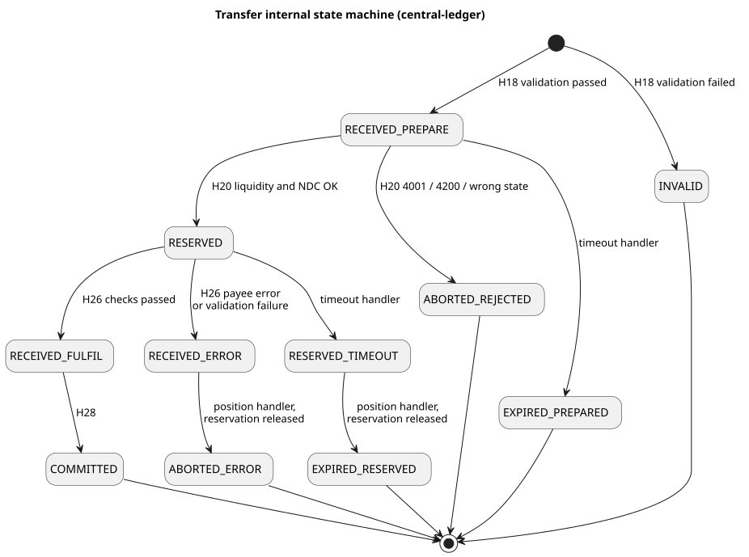

# Transfer Journey Reference

Reference tables for the transfer journey. Hop numbers (H1–H31) refer to the [phase pages](./README.md).

## Transfer state machine

These are the internal states (`TransferInternalState`, central-services-shared `src/enums/transfers.js`), stored as `transferStateChange` rows.



| Internal state | API state | Written by |
|---|---|---|
| `RECEIVED_PREPARE` | RECEIVED | `TransferFacade.saveTransferPrepared` |
| `INVALID` | ABORTED | `saveTransferPrepared` |
| `RESERVED` | RESERVED | `domain/position/prepare.js` |
| `ABORTED_REJECTED` | ABORTED | `domain/position/prepare.js` |
| `RECEIVED_FULFIL` | RESERVED | `TransferFacade.savePayeeTransferResponse` |
| `RECEIVED_ERROR` | RESERVED | `savePayeeTransferResponse` |
| `COMMITTED` | COMMITTED | `domain/position/fulfil.js` |
| `ABORTED_ERROR` | ABORTED | `domain/position/abort.js` |
| `EXPIRED_PREPARED` | ABORTED | `TransferFacade._processTimeoutEntries` |
| `RESERVED_TIMEOUT` | RESERVED | `_processTimeoutEntries` |
| `EXPIRED_RESERVED` | ABORTED | `domain/position/timeout-reserved.js` |

## Database statements per transfer

Statements issued against MySQL for this one transfer with the default configuration (`CACHE.CACHE_ENABLED=false`, `PROXY_CACHE.enabled=true`, `SIMPLE_ROUTING_MODE=true`), excluding the central-ledger admin API calls behind ALS and ml-api-adapter cache misses. The full SQL is on each phase page.

| Hop | Service | Reads | Writes | Transaction |
|---|---|---|---|---|
| H3 | ALS | 1 (`oracleEndpoint`, on cache miss) | — | — |
| H11, H15 | quoting-service | 2 each (participant account, endpoint; on cache miss) | — | — |
| H18 | prepare handler | 6× `participant`, 4× `participantCurrency` (full table), 3 account lookups, duplicate check, `fxWatchList` | `transferDuplicateCheck`, then 5 inserts | Inserts only |
| H20 | position-batch | 2× `transferStateChange`, 2× `participantCurrency` (full table), `settlementModel`, `participantPosition FOR UPDATE`, `transferParticipant`, NDC limit, empty FX lookups | 1 update, 2 inserts | Whole batch |
| H26 | fulfil handler | `getById` join, `transferExtension`, duplicate check, `settlementWindow`, `fxWatchList`, payee account lookup | `transferFulfilmentDuplicateCheck`, then 2 inserts | Inserts only (window read is outside) |
| H28 | position-batch | As H20 | 1 update, 2 inserts | Whole batch |

## Kafka topics, groups and keys

| Topic | Producer | Consumer group | Key | Hops |
|---|---|---|---|---|
| `topic-quotes-post` | quoting-service API | `group-quotes-handler-post` | — | H10 |
| `topic-quotes-put` | quoting-service API | `group-quotes-handler-put` | — | H14 |
| `topic-transfer-prepare` | ml-api-adapter API | `cl-group-transfer-prepare` | — | H17 |
| `topic-transfer-position-batch` | prepare, fulfil, timeout handlers | `cl-group-transfer-position-batch` | Position account `participantCurrencyId`: the payer's for prepare/abort/timeout, the payee's for commit | H19, H27 |
| `topic-transfer-fulfil` | ml-api-adapter API | `cl-group-transfer-fulfil` | — | H25 |
| `topic-notification-event` | central-ledger handlers | `ml-group-notification-event` | — | H21, H29 |
| `topic-transfer-get` | ml-api-adapter API | `cl-group-transfer-get` | — | `GET /transfers/{ID}` |

Topic names follow `topic-{functionality}-{action}`. central-ledger's `KAFKA.EVENT_TYPE_ACTION_TOPIC_MAP.POSITION.*` routes position actions to the batch topic. Consumer defaults are `batchSize: 1` for prepare and fulfil, and `batchSize: 10` for position-batch.

## Notification routing

"Original" means the counterparty's bytes and signature are forwarded unchanged. "Hub" means the hub builds the body and signs it with the hub key when `JWS_SIGN=true`.

| Event action · status | Recipient | Call | Body / signature |
|---|---|---|---|
| `prepare` · success | Payee | `POST /transfers` | Original |
| `prepare` · failure | Payer | `PUT /transfers/{ID}/error` | Hub |
| `prepare-duplicate` | Payer | `PUT /transfers/{ID}` (current state) | Hub |
| `commit` · success | Payer | `PUT /transfers/{ID}` | Original |
| `commit` · success | Payee | `PUT /transfers/{ID}` when `SEND_TRANSFER_CONFIRMATION_TO_PAYEE=true` | Hub |
| `reserve` · success | Payer | `PUT /transfers/{ID}` (ledger-built body) | Hub |
| `reserve` · success | Payee | `PATCH /transfers/{ID}` (no fulfilment) | Hub |
| `abort` (payee error) | Payer | `PUT /transfers/{ID}/error` | Original |
| `abort` (payee error) | Payee | `PUT /transfers/{ID}/error` when `SEND_TRANSFER_CONFIRMATION_TO_PAYEE=true` | Hub |
| `abort-validation` | Payer; payee when the flag above is on | `PUT /transfers/{ID}/error` | Hub |
| `reserved-aborted` | Payee | `PATCH /transfers/{ID}` `{ transferState: ABORTED }` | Hub |
| `timeout-received` | Payer | `PUT /transfers/{ID}/error` 3303 | Hub |
| `timeout-reserved` | Payer and payee | `PUT /transfers/{ID}/error` 3303 | Hub |

## Duplicate handling

Each stage compares the SHA-256 of the payload with the hash stored for that ID (`duplicateCheckComparator`).

| Stage | Table | Same ID, same hash | Same ID, different hash |
|---|---|---|---|
| Quote request (persistent mode) | `quoteDuplicateCheck` | `handleQuoteRequestResend` | 3106 |
| Quote response (persistent mode) | `quoteResponseDuplicateCheck` | Resend | 3106 |
| Prepare (H18) | `transferDuplicateCheck` | `COMMITTED`/`ABORTED`/`RESERVED` → `prepare-duplicate` callback with the current state; still in flight → ignored | 3106 |
| Fulfil (H26) | `transferFulfilmentDuplicateCheck` | `COMMITTED`/`ABORTED` → `fulfil-duplicate` callback; `RECEIVED`/`RESERVED` → ignored | 3106 |
| Payee error | `transferErrorDuplicateCheck` | `abort-duplicate` callback | 3106 |

## Delivery semantics, timeouts and recovery

**Offset before produce.** `Kafka.proceed` commits the consumed offset and then produces the next message; position-batch commits offsets before `trx.commit()`. Hand-offs between stages are therefore at-most-once: a crash between the two loses the hand-off rather than repeating it.

**Timeout handler** (`src/handlers/timeouts/handler.js`, cron `TIMEXP`, every 15 s by default), `TransferFacade.timeoutExpireReserved`:

1. Insert `transferTimeout { transferId, expirationDate }` for transfers whose state changes fall in the new segment interval.
2. For rows past `expirationDate`, act on the latest state:
   * `RECEIVED_PREPARE` → `EXPIRED_PREPARED`, and notify the payer.
   * `RESERVED` → `RESERVED_TIMEOUT`, plus `transferError` 3303 and a `timeout-reserved` position message (payer key) → `EXPIRED_RESERVED`. Both sides are notified.
3. `transferTimeout.cleanup()` deletes rows whose latest state is any of `RECEIVED_FULFIL`, `COMMITTED`, `FAILED`, `RESERVED_TIMEOUT`, `RECEIVED_REJECT`, `EXPIRED_PREPARED`, `EXPIRED_RESERVED`, `ABORTED_REJECTED` or `ABORTED_ERROR`.

The timeout error both sides receive for an expired reservation:

**Request:** `PUT /transfers/01JBVM16V1SZQX8B0JZ2N4ZDE4/error`

Headers:

```json
{
  "Content-Type": "application/vnd.interoperability.transfers+json;version=2.0",
  "Date": "Thu, 15 Oct 2026 09:30:30 GMT",
  "FSPIOP-Source": "Hub",
  "FSPIOP-Destination": "pinebank"
}
```

Body:

```json
{
  "errorInformation": {
    "errorCode": "3303",
    "errorDescription": "Transfer expired"
  }
}
```

| Hand-off lost | State left | Recovered by |
|---|---|---|
| H19 prepare → position | `RECEIVED_PREPARE` | Timeout → `EXPIRED_PREPARED`; nothing was reserved |
| H21 / H22 position → payee | `RESERVED` | Timeout → `EXPIRED_RESERVED`; reservation released |
| H24 payee → hub | `RESERVED` | Same |
| **H27 fulfil → position (commit)** | **`RECEIVED_FULFIL`** | **Not recovered.** `cleanup()` has already removed the `transferTimeout` row, and both sweeps join from it. The payer's reservation stays held and the transfer never reaches a final state. |
| H29 / H30 commit → payer | `COMMITTED` | The ledger is correct; DFSPs learn the outcome with `GET /transfers/{ID}` |

The H27 gap was traced from source, not reproduced. Durable producer settings (`acks=all`, replication factor 3, adequate `min.insync.replicas`) lower the chance of losing that hand-off, but they do not add a recovery path.

## Security controls by hop

Each layer below stops a different kind of attack or mistake. Controls marked *Deployment* depend on how the scheme operator installs and configures the hub. The rest are behaviour traced in the source.

| Control | Hops | Where |
|---|---|---|
| mTLS DFSP ↔ hub (*Deployment*) | Every HTTP hop crossing the hub edge | Ingress gateway (`mode: MUTUAL`), egress gateway or sidecars for callbacks; SDK `INBOUND_/OUTBOUND_MUTUAL_TLS_ENABLED` |
| Hub-internal encryption (*Deployment*) | Kafka, MySQL, service to service | Service mesh mTLS or node WireGuard; Kafka/MySQL TLS |
| JWS signing by DFSPs | H6, H9, H13, H16, H24 | SDK `JWS_SIGN` (default `true`) |
| JWS validation by DFSPs | H8, H11→payee, H15, H22→payee, H30, H31 | SDK `VALIDATE_INBOUND_JWS` (default `true`); `PUT /parties` separately (default `false`) |
| JWS validation by the hub | H16, H24 | ml-api-adapter `JWS_VALIDATE` (default `false`), non-GET `/transfers` only |
| The hub never re-signs forwarded messages | H7, H11, H15, H22, H30 | Original bytes carried in the envelope |
| The hub signs its own messages | Errors, `PATCH`, payee confirmations | `JWS_SIGN` with `FSPIOP_SOURCE_TO_SIGN` = hub |
| Requester / participant validation | H2, H4, H11, H18 | ALS, quoting handler, prepare handler |
| Source binding | H18 (`Source = payerFsp`), H26 (`Source = payeeFsp`, `Destination = payerFsp`) | central-ledger |
| ILP condition | Created at H12; form validated at H18; matched to the quote at H23; preimage verified at H26; verified by the payer at H30 | SDK, central-ledger |
| Liquidity cover and NDC under a row lock | H20 | position-batch |
| Duplicate detection | H11, H15 (persistent mode), H18, H26 | [Duplicate handling](#duplicate-handling) |
| Expiry | H18, H23, H26, timeout handler | [Delivery semantics](#delivery-semantics-timeouts-and-recovery) |
| Durable hand-offs (*Deployment*) | Every Kafka hop and ledger write | Kafka replication with `acks=all`; MySQL replication |

The JWS format (sdk-standard-components `src/lib/jws`):

```text
protectedHeader = base64url({ alg: "RS256" | "ES256",
                              "FSPIOP-URI", "FSPIOP-HTTP-Method", "FSPIOP-Source",
                              "FSPIOP-Destination" (if present), "Date" (if present) })
FSPIOP-Signature: {"signature":"<JWS signature>","protectedHeader":"<protectedHeader>"}
```

The validator rejects a request when there is no key for `FSPIOP-Source`, when `alg` is anything other than RS256 or ES256, or when the protected `FSPIOP-URI` or `FSPIOP-HTTP-Method` differs from the actual request.

## Configuration that changes the path

### Hub

| Setting | Component | Default | Effect |
|---|---|---|---|
| `SIMPLE_ROUTING_MODE` | quoting-service | `true` | `true`: route only. `false`: deduplicate and persist quotes |
| `PAYLOAD_CACHE.enabled` + `ORIGINAL_PAYLOAD_STORAGE` | ml-api-adapter | `true` + `""` | Original bytes go to Redis only when storage is `redis`; otherwise they are inline in the envelope |
| `TRANSFERS.SEND_TRANSFER_CONFIRMATION_TO_PAYEE` | ml-api-adapter | `true` | Hub-signed confirmation to the payee at H31 |
| `ENDPOINT_SECURITY.JWS.JWS_SIGN` | ml-api-adapter | `false` | The hub signs messages it originates |
| `ENDPOINT_SECURITY.JWS.JWS_VALIDATE` | ml-api-adapter | `false` | The hub validates signatures at H16/H24 |
| `HTTP_REQUEST_TIMEOUT_MS` | ml-api-adapter | `20000` | Callback timeout at H22/H30/H31 |
| `ENDPOINT_CACHE_CONFIG.expiresIn` | ml-api-adapter | `180000` | Callback URL cache TTL |
| `CACHE.CACHE_ENABLED` | central-ledger | `false` | Participant/currency/limit caching in handlers |
| `KAFKA.EVENT_TYPE_ACTION_TOPIC_MAP.POSITION.*` | central-ledger | FX actions only | Routes position actions to the batch topic |
| `POSITION_BATCH … options.batchSize` | central-ledger | `10` | Messages per position transaction |
| `HANDLERS.TIMEOUT.TIMEXP` | central-ledger | `*/15 * * * * *` | Timeout sweep schedule |
| Producer `topicConf.request.required.acks` | All producers | Per chart | Durability of each Kafka hand-off |

### DFSP connector (sdk-scheme-adapter)

| Setting | Default | Effect |
|---|---|---|
| `AUTO_ACCEPT_PARTY` / `AUTO_ACCEPT_QUOTES` | `true` / `true` | `false` pauses at H8 / H15 for customer confirmation |
| `CHECK_ILP` | `true` | Condition checks at H23 and H30 |
| `REJECT_TRANSFERS_ON_EXPIRED_QUOTES` | `false` | The payee rejects expired quotes at H23 (3302) |
| `ALLOW_TRANSFER_WITHOUT_QUOTE` | `false` | The payee accepts a prepare with no saved quote |
| `ALLOW_DIFFERENT_TRANSFER_TRANSACTION_ID` | `false` | The quote is looked up by the ILP packet's `transactionId` |
| `RESERVE_NOTIFICATION` | `false` | The payee replies `RESERVED` at H24 and waits for `PATCH` |
| `PATCH_NOTIFICATION_GRACE_TIME_MS` | `15000` | The payee polls `GET /transfers/{ID}` if no `PATCH` arrives |
| `JWS_SIGN` / `VALIDATE_INBOUND_JWS` | `true` / `true` | Message signing |
| `VALIDATE_INBOUND_PUT_PARTIES_JWS` | `false` | JWS on `PUT /parties` |
| `EXPIRY_SECONDS` | `20` | Quote and prepare expiration |

## Metrics along the path

| Metric | Hop | Measures |
|---|---|---|
| `ml_transfer_prepare` / `ml_transfer_fulfil` | H16 / H24 | API handler up to the Kafka produce |
| `transfer_prepare` / `transfer_fulfil` | H18 / H26 | Handler, per message |
| `handlers_transfer_validator` | H18, H26 | `validatePrepare`, `validateFulfilCondition`, … |
| `model_transfer` | H18, H26 | Facade DB calls; `facade_saveTransferPrepared` vs `…_transaction` brackets the COMMIT |
| `transfer_position` | H20, H28 | Position-batch, per message and per batch |
| `notification_event`, `notification_event_delivery` | H22, H30, H31 | Consume; per-callback HTTP |
| `tx_transfer_prepare` | H16 → H22 | From API prepare receipt to the payee forward |
| `tx_transfer_fulfil` | H24 → H30 | From API fulfil receipt to the payer callback |
| `tx_transfer` | H16 → H30 | End to end inside the hub |
| `model_quote` | H11, H15 | `validateQuoteRequest`, `forwardQuoteRequest`, `forwardQuoteUpdate` |
| `mojaloop_connector_callback_latency_seconds` | H22 → H24 (payee SDK) | From the inbound request to the outbound callback |

The `tx_*` metrics read `timeApiPrepare`/`timeApiFulfil` from the W3C `tracestate`. They are therefore wide spans that contain every Kafka hop and DB commit in between.

## Failure outcomes

Every failure ends in a clear, final answer to the DFSPs involved.

| What happened | Caught at | Outcome | Code |
|---|---|---|---|
| Identifier not registered with any DFSP | Discovery (H3) | Party not found; nothing reserved | 3204 |
| Payee DFSP declines to quote | Quote (H12) | Quote error to the payer DFSP; nothing reserved | 5101 |
| Malformed instruction, wrong sender, inactive participant, expiry passed | H18 prepare | Stored as `INVALID`; error to the payer DFSP | 3100 |
| Same ID resent with different contents | H18 / H26 | Rejected as a modified request | 3106 |
| Payer DFSP lacks liquidity cover | H20 position | `ABORTED_REJECTED` | 4001 |
| Payer DFSP would exceed its Net Debit Cap | H20 position | `ABORTED_REJECTED` | 4200 |
| Signature does not verify | H16 (if enabled) or H23 | Message refused | 3105 |
| Quote expired before the transfer arrived | H23 payee | Payee error; reservation released | 3302 |
| Payee DFSP rejects the transfer | H23 payee | `ABORTED_ERROR`; reservation released | 5104 |
| Fulfilment does not match the condition, or wrong sender | H26 fulfil | Aborted; reservation released | 3100 |
| Payee DFSP never answers | Timeout handler | `RESERVED_TIMEOUT` → `EXPIRED_RESERVED`; reservation released | 3303 |

## Error codes

| Code | Name | Raised at |
|---|---|---|
| 2001 | Internal server error | H20 wrong state; H26 transfer not found; any unexpected failure |
| 3100 | Generic validation error | H18 validation; H26 header/condition/state checks |
| 3101 | Malformed syntax | Hub ingress header and body validation |
| 3105 | Invalid signature | JWS validation (hub or DFSP) |
| 3106 | Modified request | Any duplicate check with a different hash |
| 3204 | Party not found | Discovery |
| 3208 | Transfer ID not found | `GET /transfers/{ID}` |
| 3302 | Quote expired | H23 |
| 3303 | Transfer expired | H26; timeout handler |
| 4001 | Payer FSP insufficient liquidity | H20 |
| 4200 | Payer limit error | H20 |
| 5101 | Payee rejected quote | H12 |
| 5104 | Payee rejected transaction | H23 |

## Glossary

| Term | Meaning |
|---|---|
| DFSP | Digital Financial Service Provider: a bank, wallet or other provider that is a participant in the hub |
| FSPIOP | The FSP Interoperability API, the open specification Mojaloop messages follow. ISO 20022 is also supported and translated at the edge. |
| SDK scheme adapter (Mojaloop Connector) | Software a DFSP runs to speak FSPIOP to the hub, including signing and ILP handling |
| Oracle | A directory that maps an identifier, such as an MSISDN, to the DFSP that holds it |
| Callback | The answer to a request, delivered later as a separate HTTP call to an endpoint the receiver registered |
| Condition | SHA-256 hash of the fulfilment, published with the quote and attached to the transfer |
| Fulfilment | A 32-byte secret whose SHA-256 hash equals the condition. Only the payee DFSP can produce it. |
| Position | A DFSP's running net balance with the hub in one currency |
| Liquidity cover | Funds the DFSP has deposited at the settlement bank, held on its SETTLEMENT account |
| Net Debit Cap (NDC) | The maximum net amount a DFSP may owe before the next settlement |
| Settlement window | The period whose committed transfers are netted and settled together |
| mTLS · JWS | Mutually authenticated TLS connections · JSON Web Signatures on each message |
